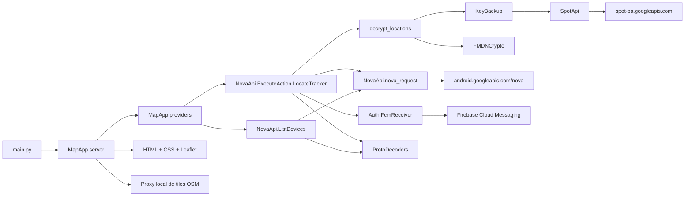
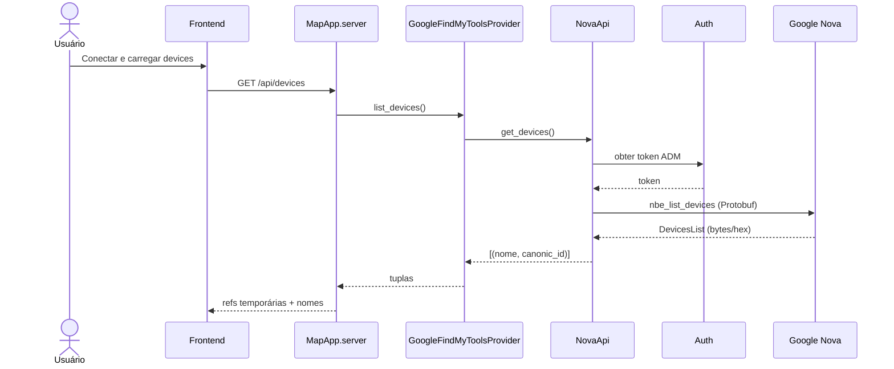
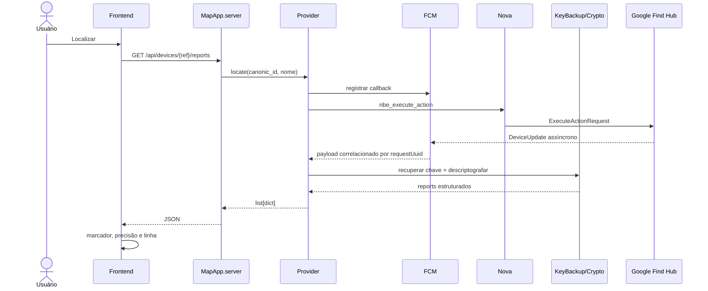
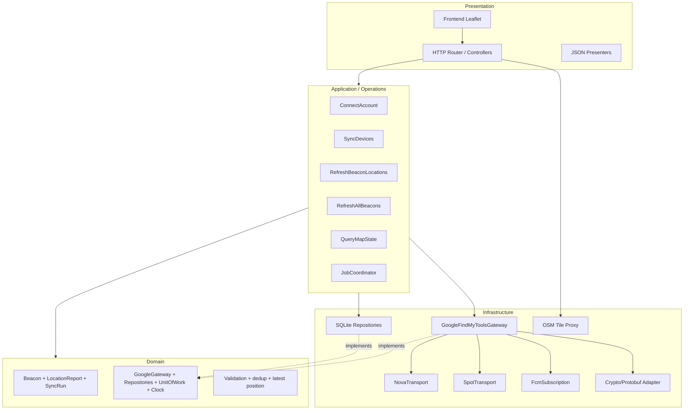
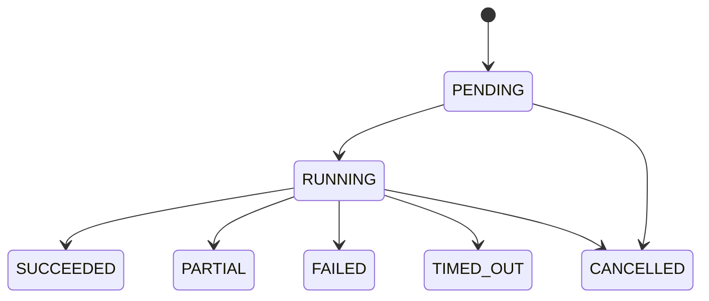
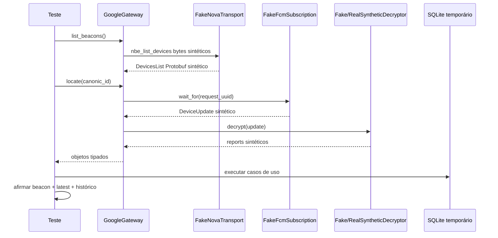

# Arquitetura do GoogleFindMyTools Map

> Blueprint vivo para mapear, implementar, testar e revisar o aplicativo local de consulta e visualização de beacons do Google Find Hub.

## Controle do documento

| Campo | Valor |
|---|---|
| Estado | Blueprint de implementação |
| Data-base | 2026-10-19 |
| Fonte primária | Código deste repositório |
| Banco escolhido | SQLite local |
| Interface | HTTP localhost + frontend Leaflet |
| Integração externa | Interfaces reimplementadas do Google Find Hub usadas pelo GoogleFindMyTools |
| Regra de evidência | Não inferir como o servidor Google funciona além do que o cliente local demonstra |

### Legenda de estado

- **EXISTENTE**: observado no código atual.
- **A REFATORAR**: existe, mas não atende ao contrato-alvo.
- **A CRIAR**: requisito ainda não implementado.
- **DESCONHECIDO**: comportamento pertencente ao Google ou não validado em execução real.
- **MANUAL/OPT-IN**: operação que exige ação explícita do usuário e não participa da suíte automática.

## Bloco documental

BLOCK-ID: ARCH-001
TYPE: definir / documentar
DESCRIPTION: mapear o sistema GoogleFindMyTools atual e definir a arquitetura completa do aplicativo de mapa solicitada pelo cliente.
INPUT: fonte Python, contratos Protobuf, frontend atual, testes existentes e requisitos do cliente.
OPERATION: inventário estático, mapeamento dos fluxos, identificação de lacunas e desenho das camadas, contratos, banco, API, testes e plano incremental.
EXPECTED OUTPUT: este arquivo utilizável como fonte de decisões e ordem de desenvolvimento.
ACCEPTANCE CRITERIA: cada requisito do cliente possui componentes, contratos, dados, testes e bloco de implementação correspondentes.
LOCAL TEST: validar estrutura Markdown, referências a caminhos existentes, ausência de padrões de segredo e sintaxe dos blocos de código ilustrativos.
REUSABLE RULE: nenhuma funcionalidade entra no frontend sem atravessar um caso de uso e um contrato de domínio; nenhuma integração externa entra em teste automático sem um adaptador substituível.
DEPENDENCIES: somente fonte local; nenhum login ou acesso aos serviços Google é necessário para validar este documento.
RESULT: ARCH-001 a ARCH-014 completos; implementação, smoke real, instalação limpa, licenças e preparação do PR validados.
NEXT BLOCK: nenhum bloco de implementação pendente; revisar o diff e publicar o pull request quando autorizado.

---

## 1. Objetivo do produto

Construir uma aplicação local que:

1. autentique o usuário pelo fluxo interativo já existente;
2. consulte os beacons/devices associados à conta;
3. solicite relatórios de localização ao Google Find Hub;
4. correlacione a resposta assíncrona recebida por FCM;
5. descriptografe os relatórios no backend local;
6. normalize dispositivos e localizações em objetos de domínio;
7. persista o inventário e o histórico em SQLite;
8. exponha somente dados sanitizados em uma API localhost;
9. mostre as posições mais recentes e o histórico no mapa;
10. seja testável sem conta Google, rede, Chrome ou localização real.

O MVP é local e de usuário único. Multiusuário, hospedagem pública e sincronização em nuvem estão fora do escopo inicial.

## 2. Tradução dos requisitos do cliente

| Requisito do cliente | Entrega arquitetural | Evidência de aceite |
|---|---|---|
| Remover localizações definidas diretamente | `DemoReportsProvider` fica restrito a demo/testes; produção usa `GoogleGateway` | modo real não importa fixtures e teste garante a seleção do provider |
| Consultar tags pela API Google | adaptador `GoogleFindMyToolsGateway` sobre Nova, Spot, FCM e Crypto | teste de integração simulado cobre request, callback, decode e retorno |
| Complementar com geolocalização | normalizador transforma Protobuf descriptografado em `LocationReport` | latitude/longitude, precisão, altitude, horário e status validados |
| Banco local | SQLite com migrations e repositories | reiniciar a aplicação preserva beacons e histórico |
| Registro dos beacons | tabela `beacons` | upsert idempotente por ID canônico |
| Posições mais recentes | view/consulta `beacon_latest_locations` | uma posição mais nova substitui a anterior na leitura, sem apagar histórico |
| Priorizar fluxo Google | blocos de integração antecedem melhorias visuais | integração simulada aprovada antes de novas features do frontend |
| Testes unitários | domínio, normalização, repositories e casos de uso isolados | suíte sem rede e determinística |
| Testes de integração simulados | transportes Nova/Spot/FCM falsos e SQLite temporário | fluxo completo salva e retorna report sintético |
| Separação clara | Domain, Application, Infrastructure e Presentation | dependências seguem a direção definida neste documento |

## 3. Limites e classificação da integração Google

O código usa interfaces reimplementadas e não uma API pública estável documentada para este produto. Portanto:

- o comportamento do cliente local é **EXISTENTE** e pode ser testado;
- autorização, limites, estabilidade e semântica do serviço remoto são **DESCONHECIDOS** até validação real;
- testes automáticos não devem acessar contas, tokens, localizações ou serviços Google;
- teste real é **MANUAL/OPT-IN**, executado com consentimento e sem gravar material sensível em logs;
- mudanças de endpoints, Chrome, autenticação ou Protobuf devem ser tratadas como falhas de integração, não como regras de domínio.

## 4. Arquitetura atual mapeada

### 4.1 Visão geral



### 4.2 Componentes existentes no inventário inicial

> Snapshot histórico do ARCH-001. O estado implementado final está consolidado nas seções 22 e 23.

| Caminho | Estado | Responsabilidade observada | Problema para a arquitetura-alvo |
|---|---|---|---|
| `main.py` | EXISTENTE | argumentos, servidor e abertura do navegador | composição ainda conhece detalhes concretos |
| `MapApp/server.py` | A REFATORAR | HTTP, API, arquivos estáticos, registry e tiles | mistura apresentação, segurança, proxy e dependências |
| `MapApp/providers.py` | A REFATORAR | provider real e provider demo | contratos são tuplas/dicionários sem tipos de domínio |
| `MapApp/static/*` | EXISTENTE | lista, ações e mapa Leaflet | lê apenas memória do processo; não consulta histórico persistido |
| `NovaApi/ListDevices/nbe_list_devices.py` | A REFATORAR | monta request, consulta e lista devices | também atualiza trackers customizados; responsabilidades acopladas |
| `NovaApi/nova_request.py` | A REFATORAR | POST Nova autenticado | imprime erro e pode retornar `None`; sem erro tipado ou injeção de transporte |
| `LocateTracker/location_request.py` | A REFATORAR | FCM, request, correlação e timeout | espera bloqueante; callback não é removido explicitamente |
| `LocateTracker/decrypt_locations.py` | A REFATORAR | chave, descriptografia e conversão de coordenadas | crypto, parsing e construção do resultado estão unidos |
| `Auth/*` | EXISTENTE/SENSÍVEL | login, tokens, cache e FCM | usa arquivo de segredos; contém interação e prints; não pode vazar à API |
| `SpotApi/*` | EXISTENTE | RPC Spot, owner key, registro e EIDs | transporte e casos de uso misturados |
| `KeyBackup/*` | EXISTENTE/SENSÍVEL | recuperação e descriptografia das chaves | fluxos interativos usam `input`, `print` e exceções genéricas |
| `FMDNCrypto/*` | EXISTENTE | primitivas e derivação criptográfica | deve permanecer isolado e testado por vetores sintéticos |
| `ProtoDecoders/*.proto` | EXISTENTE | contratos binários | fonte de verdade; arquivos `*_pb2.py` são gerados |
| `tests/test_map_app.py` | A REFATORAR | testes HTTP com provider/tile sintéticos | não cobre integração Google simulada nem banco |
| banco local | A CRIAR | persistência | inexistente |

### 4.3 Fluxo atual de listagem



### 4.4 Fluxo atual de localização



### 4.5 Dados de localização observados

Os esquemas e o código suportam:

- `latitude` e `longitude` como `sfixed32`, convertidos por divisão por `1e7`;
- altitude inteira;
- precisão em metros;
- timestamp em segundos e nanos;
- status `SEMANTIC`, `LAST_KNOWN`, `CROWDSOURCED` ou `AGGREGATED`;
- indicador de relatório próprio;
- localização semântica com nome, sem coordenadas obrigatórias;
- reports recentes e reports da rede;
- identificação e metadados básicos do device.

## 5. Lacunas da implementação atual

1. Não existe banco local.
2. O `DeviceRegistry` perde suas referências ao reiniciar ou recarregar devices.
3. O frontend só conhece os reports retornados na sessão atual.
4. O provider real não possui DTOs, erros ou interfaces de transporte estáveis.
5. O modo demo contém posições fixas; ele deve continuar apenas como fixture.
6. Os testes cobrem apenas provider demo, HTTP e tiles.
7. A espera por FCM bloqueia a thread HTTP até resposta ou timeout.
8. O singleton FCM acumula callbacks; falta assinatura removível e encerramento controlado.
9. `nova_request` e `spot_request` imprimem erros em vez de levantar erros tipados.
10. Os fluxos de chaves podem chamar `input()`, abrir Chrome ou finalizar o processo.
11. Não há jobs, progresso, cancelamento, retry controlado ou estado de sincronização.
12. Não há deduplicação persistente dos reports.
13. Não há migrations, política de retenção ou backup do banco.
14. Não há teste de integração simulado do Protobuf/FCM/crypto até SQLite.
15. A validação real com conta Google permanece MANUAL/OPT-IN.

## 6. Princípios da arquitetura-alvo

1. **Dependência para dentro**: apresentação e infraestrutura dependem de contratos; domínio não depende de Google, HTTP ou SQLite.
2. **Integração substituível**: Google real, fake e fixture implementam a mesma porta.
3. **Persistência antes da UI**: a API lê o estado do banco; operações atualizam o banco em transações.
4. **Segredos ficam fora do domínio e do frontend**.
5. **IDs internos não atravessam a API**: o frontend usa `public_id` estável e aleatório.
6. **UTC em persistência**: conversão para fuso local ocorre apenas na apresentação.
7. **Idempotência**: sincronizar novamente não duplica beacon nem report.
8. **Operações externas são jobs**: HTTP não fica preso esperando FCM indefinidamente.
9. **Erros tipados e sanitizados**: detalhes técnicos em log redigido; mensagem segura na API.
10. **Rede zero nos testes automáticos**.

## 7. Arquitetura-alvo



### Regra de dependência

```text
Presentation  ─────┐
                   ├──> Application ───> Domain
Infrastructure ────┘          ^
                               |
                         interfaces/ports
```

`Domain` não pode importar `Auth`, `NovaApi`, `SpotApi`, `sqlite3`, `http.server` ou módulos de frontend.

## 8. Estrutura de diretórios proposta

```text
MapApp/
├── bootstrap.py
├── config.py
├── domain/
│   ├── models.py
│   ├── errors.py
│   ├── validation.py
│   └── ports.py
├── application/
│   ├── dto.py
│   ├── connect_account.py
│   ├── sync_devices.py
│   ├── refresh_locations.py
│   ├── query_map.py
│   └── jobs.py
├── infrastructure/
│   ├── google/
│   │   ├── gateway.py
│   │   ├── nova_transport.py
│   │   ├── spot_transport.py
│   │   ├── fcm_subscription.py
│   │   ├── protobuf_mapper.py
│   │   └── legacy_adapters.py
│   ├── persistence/
│   │   ├── connection.py
│   │   ├── migrations.py
│   │   ├── beacon_repository.py
│   │   ├── location_repository.py
│   │   └── sync_repository.py
│   └── maps/
│       └── tile_proxy.py
├── presentation/
│   └── http/
│       ├── server.py
│       ├── routes.py
│       ├── presenters.py
│       └── security.py
└── static/
    ├── index.html
    ├── styles.css
    └── app.js

migrations/
├── 001_initial.sql
└── 002_indexes.sql

tests/
├── fixtures/
│   ├── devices.py
│   └── location_updates.py
├── unit/
├── integration/
├── contract/
└── e2e/
```

Os módulos legados permanecem inicialmente em `Auth/`, `NovaApi/`, `SpotApi/`, `KeyBackup/`, `FMDNCrypto/` e `ProtoDecoders/`. `legacy_adapters.py` os encapsula até que refatorações isoladas sejam seguras.

## 9. Modelo de domínio

### 9.1 `Beacon`

| Campo | Tipo | Regra |
|---|---|---|
| `id` | inteiro interno | definido pelo repository |
| `public_id` | UUID/string aleatória | única; única identificação exposta ao frontend |
| `canonic_id` | string sensível | única; somente backend/DB |
| `display_name` | string | pode ser atualizado pelo Google |
| `device_type` | string opcional | enum normalizado, não número Protobuf cru |
| `manufacturer` | string opcional | metadado observado |
| `model` | string opcional | metadado observado |
| `image_url` | string opcional | validar esquema e origem antes de exibir |
| `first_seen_at` | timestamp UTC | imutável |
| `last_discovered_at` | timestamp UTC | atualizado na sincronização |
| `is_active` | booleano | false quando ausente conforme política explícita |

### 9.2 `LocationReport`

| Campo | Tipo | Regra |
|---|---|---|
| `id` | inteiro | definido pelo repository |
| `beacon_id` | FK | obrigatório |
| `kind` | `POINT` ou `SEMANTIC` | discriminador |
| `latitude` | float opcional | `[-90, 90]`; obrigatório em `POINT` |
| `longitude` | float opcional | `[-180, 180]`; obrigatório em `POINT` |
| `altitude` | inteiro opcional | metros |
| `accuracy` | float opcional | `>= 0` |
| `semantic_name` | string opcional | obrigatório em `SEMANTIC` |
| `observed_at` | timestamp UTC | proveniente do report |
| `status` | enum | `SEMANTIC`, `LAST_KNOWN`, `CROWDSOURCED`, `AGGREGATED` |
| `is_own_report` | booleano | origem lógica do report |
| `dedup_key` | hash/string | único e determinístico |
| `received_at` | timestamp UTC | relógio local injetado |

### 9.3 `SyncRun`

| Campo | Tipo | Regra |
|---|---|---|
| `id` | UUID | também usado como job ID |
| `operation` | enum | `CONNECT`, `SYNC_DEVICES`, `REFRESH_ONE`, `REFRESH_ALL` |
| `status` | enum | `PENDING`, `RUNNING`, `SUCCEEDED`, `PARTIAL`, `FAILED`, `TIMED_OUT`, `CANCELLED` |
| `started_at`, `finished_at` | UTC | auditabilidade |
| contadores | inteiros | devices lidos, reports recebidos/inseridos/duplicados |
| `error_code` | string opcional | classificação segura |
| `error_message` | string opcional | sem payload, token, chave ou coordenada |

## 10. Banco de dados SQLite

### 10.1 Local e ciclo de vida

- caminho padrão: diretório de dados do usuário, não o repositório;
- override para testes por argumento/configuração;
- `PRAGMA foreign_keys = ON`;
- `PRAGMA journal_mode = WAL`;
- `PRAGMA busy_timeout = 5000`;
- uma conexão por unidade de trabalho/thread;
- migrations executadas na inicialização antes de abrir o navegador;
- backup e retenção são operações explícitas;
- nunca armazenar tokens, PIN/LSKF, cookies, chaves ou payloads criptográficos no SQLite.

### 10.2 Esquema inicial

```sql
CREATE TABLE schema_migrations (
    version INTEGER PRIMARY KEY,
    applied_at INTEGER NOT NULL
);

CREATE TABLE beacons (
    id INTEGER PRIMARY KEY AUTOINCREMENT,
    public_id TEXT NOT NULL UNIQUE,
    canonic_id TEXT NOT NULL UNIQUE,
    display_name TEXT NOT NULL,
    device_type TEXT,
    manufacturer TEXT,
    model TEXT,
    image_url TEXT,
    is_active INTEGER NOT NULL DEFAULT 1 CHECK (is_active IN (0, 1)),
    first_seen_at INTEGER NOT NULL,
    last_discovered_at INTEGER NOT NULL,
    created_at INTEGER NOT NULL,
    updated_at INTEGER NOT NULL
);

CREATE TABLE location_reports (
    id INTEGER PRIMARY KEY AUTOINCREMENT,
    beacon_id INTEGER NOT NULL REFERENCES beacons(id) ON DELETE CASCADE,
    kind TEXT NOT NULL CHECK (kind IN ('POINT', 'SEMANTIC')),
    latitude REAL CHECK (latitude BETWEEN -90.0 AND 90.0),
    longitude REAL CHECK (longitude BETWEEN -180.0 AND 180.0),
    altitude INTEGER,
    accuracy REAL CHECK (accuracy IS NULL OR accuracy >= 0),
    semantic_name TEXT,
    observed_at INTEGER NOT NULL,
    status TEXT NOT NULL CHECK (
        status IN ('SEMANTIC', 'LAST_KNOWN', 'CROWDSOURCED', 'AGGREGATED')
    ),
    is_own_report INTEGER NOT NULL CHECK (is_own_report IN (0, 1)),
    dedup_key TEXT NOT NULL UNIQUE,
    received_at INTEGER NOT NULL,
    CHECK (
        (kind = 'POINT' AND latitude IS NOT NULL AND longitude IS NOT NULL)
        OR
        (kind = 'SEMANTIC' AND semantic_name IS NOT NULL)
    )
);

CREATE TABLE sync_runs (
    id TEXT PRIMARY KEY,
    operation TEXT NOT NULL,
    status TEXT NOT NULL,
    beacon_public_id TEXT,
    started_at INTEGER,
    finished_at INTEGER,
    devices_discovered INTEGER NOT NULL DEFAULT 0,
    reports_received INTEGER NOT NULL DEFAULT 0,
    reports_inserted INTEGER NOT NULL DEFAULT 0,
    reports_duplicated INTEGER NOT NULL DEFAULT 0,
    error_code TEXT,
    error_message TEXT
);

CREATE INDEX idx_locations_beacon_time
    ON location_reports(beacon_id, observed_at DESC);

CREATE INDEX idx_sync_runs_started
    ON sync_runs(started_at DESC);

CREATE VIEW beacon_latest_locations AS
SELECT lr.*
FROM location_reports lr
JOIN (
    SELECT beacon_id, MAX(observed_at) AS max_observed_at
    FROM location_reports
    WHERE kind = 'POINT'
    GROUP BY beacon_id
) latest
ON latest.beacon_id = lr.beacon_id
AND latest.max_observed_at = lr.observed_at
WHERE lr.kind = 'POINT';
```

### 10.3 Deduplicação

`dedup_key` deve ser produzido no domínio a partir de uma representação canônica:

```text
SHA-256(beacon_public_id | kind | observed_at | latitude | longitude | status | is_own_report)
```

Não incluir token, chave ou ID canônico no hash exposto. Inserção usa `INSERT ... ON CONFLICT(dedup_key) DO NOTHING` e retorna se o report foi inserido ou já existia.

## 11. Portas e contratos

As assinaturas abaixo são blueprint; nomes podem ser ajustados sem alterar a separação.

```python
class GoogleGateway(Protocol):
    def list_beacons(self) -> list[DiscoveredBeacon]: ...
    def locate(self, canonic_id: str, timeout_seconds: float) -> list[RawLocationReport]: ...

class BeaconRepository(Protocol):
    def upsert_discovered(self, beacon: DiscoveredBeacon, now: int) -> Beacon: ...
    def get_by_public_id(self, public_id: str) -> Beacon | None: ...
    def list_active(self) -> list[Beacon]: ...

class LocationRepository(Protocol):
    def add_many(self, reports: list[LocationReport]) -> InsertSummary: ...
    def latest_by_beacon(self) -> list[LocationReport]: ...
    def history(self, beacon_id: int, limit: int) -> list[LocationReport]: ...

class UnitOfWork(Protocol):
    beacons: BeaconRepository
    locations: LocationRepository
    sync_runs: SyncRunRepository
    def __enter__(self): ...
    def commit(self) -> None: ...
    def rollback(self) -> None: ...

class Clock(Protocol):
    def now_utc_seconds(self) -> int: ...
```

### DTOs públicos

```text
DeviceSummary
  public_id, name, type, manufacturer, model, active, latest_location

LocationPoint
  latitude, longitude, altitude, accuracy, observed_at, status, own_report

SemanticLocation
  name, observed_at, status

SyncStatus
  job_id, operation, status, progress, safe_error
```

Campos proibidos em DTO público: `canonic_id`, token, cookie, FCM registration token, Android ID, PIN/LSKF, chaves, bytes criptografados, payload Protobuf bruto e conteúdo de `Auth/secrets.json`.

## 12. Adaptador Google

### 12.1 Responsabilidades

`GoogleFindMyToolsGateway` deve:

1. chamar transportes injetados;
2. construir/parsear Protobuf pelos schemas existentes;
3. mapear resultados para objetos de integração tipados;
4. correlacionar `requestUuid`;
5. aplicar timeout e cancelar/remover a assinatura FCM;
6. descriptografar somente no backend;
7. converter falhas legadas em erros tipados;
8. nunca imprimir payloads ou segredos.

### 12.2 Subportas para teste

```python
class NovaTransport(Protocol):
    def call(self, scope: str, payload: bytes) -> bytes: ...

class SpotTransport(Protocol):
    def call(self, method: str, payload: bytes) -> bytes: ...

class FcmSubscription(Protocol):
    registration_id: str
    def wait_for(self, request_uuid: str, timeout: float) -> bytes: ...
    def close(self) -> None: ...

class LocationDecryptor(Protocol):
    def decrypt(self, update) -> list[RawLocationReport]: ...
```

Fakes implementam essas interfaces sem rede. Os módulos atuais entram inicialmente por wrappers:

| Porta | Implementação legada inicial |
|---|---|
| `NovaTransport` | `NovaApi.nova_request.nova_request` |
| `SpotTransport` | `SpotApi.spot_request.spot_request` |
| `FcmSubscription` | wrapper sobre `Auth.fcm_receiver.FcmReceiver` |
| `LocationDecryptor` | wrapper sobre `decrypt_location_response_locations` |

### 12.3 Catálogo de erros

| Erro | HTTP | Retry | Exposição |
|---|---:|---|---|
| `AuthenticationRequired` | 401 | após login | mensagem segura |
| `AuthenticationExpired` | 401 | renovar uma vez | sem token |
| `GoogleUnavailable` | 502 | backoff limitado | código e correlação |
| `RateLimited` | 429/503 | `Retry-After` se conhecido | sem resposta bruta |
| `LocationTimeout` | 504 | ação do usuário | device por `public_id` |
| `MalformedGoogleResponse` | 502 | não automático | hash do fixture, não payload |
| `KeyUnavailable` | 409 | requer fluxo interativo | sem versão/chave sensível no frontend |
| `DecryptionFailed` | 422 | não automático | código genérico |
| `PersistenceFailed` | 500 | transação rollback | sem SQL/dados |

## 13. Casos de uso

### 13.1 `ConnectAccount`

- **Entrada**: confirmação explícita do usuário.
- **Ação**: executa/verifica autenticação interativa existente.
- **Saída**: estado conectado/desconectado, nunca o token.
- **Teste**: fake auth retorna sucesso, cancelamento e expiração.
- **Observação**: abrir Chrome é MANUAL/OPT-IN.

### 13.2 `SyncDevices`

```text
GoogleGateway.list_beacons
  -> validar e normalizar
  -> transaction
  -> upsert beacons
  -> atualizar last_discovered_at
  -> registrar SyncRun
  -> commit
```

Ausência temporária de um beacon não deve removê-lo automaticamente. A política de inativação precisa de janela configurável ou ação do usuário.

### 13.3 `RefreshBeaconLocations`

```text
buscar Beacon por public_id
  -> GoogleGateway.locate(canonic_id)
  -> validar reports
  -> gerar dedup_key
  -> transaction
  -> inserir novos reports
  -> atualizar SyncRun
  -> commit
```

### 13.4 `RefreshAllBeacons`

- executar sequencialmente no MVP, pois o FCM atual é singleton;
- continuar após falha isolada e terminar como `PARTIAL`;
- publicar progresso `concluídos/total`;
- permitir cancelamento entre devices;
- nunca disparar múltiplos listeners FCM concorrentes sem prova de isolamento.

### 13.5 `QueryMapState`

- lê somente SQLite;
- retorna beacons e posição mais recente;
- não chama Google;
- responde mesmo offline usando o último estado persistido;
- histórico é paginado e limitado.

## 14. Jobs e concorrência

Operações Google devem sair da thread de requisição HTTP.



MVP recomendado: `ThreadPoolExecutor(max_workers=1)` para jobs Google e executor separado ou acesso direto para tiles. O estado durável do job fica em `sync_runs`; objetos de cancelamento ficam em memória.

## 15. API HTTP localhost proposta

Base: `/api/v1`. Respostas usam `application/json; charset=utf-8`.

| Método | Rota | Caso de uso | Resposta |
|---|---|---|---|
| `GET` | `/health` | saúde local | versão, DB e estado do worker |
| `GET` | `/session` | estado de autenticação | conectado/desconectado, sem identidade sensível |
| `POST` | `/session/connect` | `ConnectAccount` | `202` + job |
| `POST` | `/sync/devices` | `SyncDevices` | `202` + job |
| `POST` | `/sync/locations` | `RefreshAllBeacons` | `202` + job |
| `GET` | `/jobs/{job_id}` | consultar job | `SyncStatus` |
| `POST` | `/jobs/{job_id}/cancel` | cancelar | estado atualizado |
| `GET` | `/devices` | listar banco | `DeviceSummary[]` |
| `GET` | `/devices/{public_id}` | detalhes | device + última posição |
| `POST` | `/devices/{public_id}/refresh` | atualizar um | `202` + job |
| `GET` | `/devices/{public_id}/locations` | histórico | lista paginada |
| `GET` | `/map/latest` | estado do mapa | GeoJSON sanitizado |

### Exemplo de GeoJSON

```json
{
  "type": "FeatureCollection",
  "features": [
    {
      "type": "Feature",
      "geometry": {"type": "Point", "coordinates": [-46.0, -23.0]},
      "properties": {
        "device_public_id": "example-public-id",
        "name": "Beacon",
        "observed_at": 0,
        "accuracy": 0,
        "status": "CROWDSOURCED",
        "own_report": false
      }
    }
  ]
}
```

O exemplo é **ILUSTRATIVO** e não representa localização real.

## 16. Frontend

**Estado implementado no ARCH-010:** a UI abre lendo `/api/v1/devices` e `/api/v1/map/latest`, acompanha jobs por polling, recarrega o cache ao final, permite atualizar um device ou todos e carrega o histórico SQLite sob demanda. O mesmo servidor da API entrega os arquivos estáticos e aceita um provedor de tiles injetável. A ligação definitiva do `main.py` ao servidor novo permanece no ARCH-012.

### Estado da UI

```text
bootstrap
  -> GET /devices + GET /map/latest
  -> renderizar cache local imediatamente
  -> usuário solicita sincronização
  -> POST /sync/...
  -> polling GET /jobs/{id}
  -> ao concluir, recarregar /devices e /map/latest
```

### Requisitos

- diferenciar “último dado salvo” de “sincronizando agora”;
- exibir horário e idade do report;
- não prometer localização ao vivo;
- marcador por device e círculo de precisão;
- linha temporal apenas quando o histórico é solicitado;
- status vazio, offline, parcial, timeout e erro;
- navegação por teclado, foco visível e `aria-live`;
- não inserir nomes externos com `innerHTML` sem escape;
- nunca colocar ID canônico, token ou payload em DOM, URL ou console;
- tiles não devem conter coordenadas do report em query string; somente viewport padrão do mapa.

## 17. Segurança e privacidade

**Estado implementado no ARCH-011:** o servidor aceita bind somente em loopback, valida `Host` em todas as requisições, exige `Origin` local e token CSRF efêmero nos `POST`, entrega CSP e cabeçalhos defensivos e mantém o log HTTP desativado. Testes negativos confirmam que requisições recusadas não iniciam jobs.

1. Bind padrão obrigatório em `127.0.0.1`.
2. Recusar `Host` inesperado para mitigar DNS rebinding.
3. Validar `Origin` em operações `POST`.
4. Usar token CSRF de sessão para endpoints mutáveis.
5. CSP restrita; preferir dependências frontend vendorizadas antes da distribuição.
6. `Auth/secrets.json` permanece ignorado e nunca é copiado para banco, testes, commits ou respostas.
7. Logs não contêm coordenadas, nomes de conta, IDs canônicos, tokens, chaves ou payloads.
8. Banco deve ter permissões somente do usuário local.
9. Exportação, exclusão e retenção precisam ser ações explícitas.
10. Nenhum teste CI usa credencial real.
11. Erros retornam `correlation_id`, não stack trace.
12. Revisar licença GPL-3.0 e atribuições de Leaflet/OSM antes de distribuir.

## 18. Observabilidade

Eventos estruturados permitidos:

```text
job_started: correlation_id, operation
device_sync_completed: correlation_id, count
location_refresh_completed: correlation_id, inserted_count, duplicate_count
job_failed: correlation_id, safe_error_code
```

Campos proibidos: coordenadas, nome/email da conta, ID canônico, request/response bruto, token, chave e conteúdo descriptografado.

Métricas locais opcionais:

- duração de jobs;
- taxa de sucesso/timeout;
- quantidade de reports novos/duplicados;
- idade do dado mais recente;
- tamanho do banco.

## 19. Configuração

| Configuração | Padrão | Regra |
|---|---|---|
| `host` | `127.0.0.1` | não expor rede por padrão |
| `port` | `8765` | permitir override |
| `database_path` | diretório de dados do usuário | nunca dentro de fixture/segredos |
| `google_timeout_seconds` | `60` | por device |
| `google_worker_count` | `1` | preservar FCM singleton no MVP |
| `history_limit` | `500` | paginação obrigatória |
| `retention_days` | desabilitado | exclusão só após decisão explícita |
| `demo_mode` | `false` | explícito por argumento |
| `open_browser` | `true` | configurável |

Segredos não são configuração comum e não devem ser aceitos em argumentos de linha de comando.

## 20. Estratégia de testes

### 20.1 Unitários

| Alvo | Casos mínimos |
|---|---|
| validação de coordenadas | limites, NaN, infinito e ausência |
| timestamp | segundos/nanos, UTC e ordem |
| `Beacon` | IDs, nomes vazios e atualização |
| `LocationReport` | POINT/SEMANTIC e invariantes |
| deduplicação | repetição idempotente |
| repositories | upsert, latest, histórico e rollback |
| casos de uso | sucesso, parcial, timeout e cancelamento |
| presenters | ausência de campos sensíveis |

### 20.2 Integração local

- SQLite temporário real;
- migrations reais;
- servidor HTTP em porta aleatória;
- `FakeGoogleGateway` determinístico;
- reinício do servidor preservando dados;
- concorrência de leitura enquanto um job escreve;
- falha de persistência provoca rollback;
- tile fetcher sintético, sem rede.

### 20.3 Integração Google simulada

O teste solicitado pelo cliente deve simular o fluxo abaixo:



Fixtures devem ser geradas com os `.proto`, conter apenas IDs/coordenadas artificiais e passar por varredura de segredos.

### 20.4 Contratos

- `GoogleGateway` real e fake passam a mesma suíte;
- repositories SQLite obedecem às portas;
- JSON da API é validado por schema;
- Protobuf sintético cobre `LAST_KNOWN`, `CROWDSOURCED`, `AGGREGATED` e `SEMANTIC`;
- erro Nova/Spot/FCM é convertido para erro de aplicação.

### 20.5 Browser/E2E

Fluxos visíveis obrigatórios:

1. abrir com banco vazio;
2. modo demo → sincronizar → marcadores aparecem;
3. reiniciar → dados continuam visíveis;
4. localizar um device;
5. localizar todos com progresso;
6. abrir popup, histórico e círculo de precisão;
7. timeout e falha parcial;
8. navegação móvel e teclado.

### 20.6 Smoke real

**Execução observada:** o ARCH-013 foi aprovado em 2026-10-19 com inventário real, uma atualização de localização e persistência após reinício. A sessão em cache estava válida, então uma nova janela de login não foi necessária. Evidência sanitizada: [`artifacts/ARCH-013-SMOKE.md`](artifacts/ARCH-013-SMOKE.md).

- nunca executado em CI;
- requer autorização explícita do usuário;
- login em janela oficial visível;
- uma conta/device controlados;
- nenhuma captura de token, chave ou coordenada em artefatos;
- resultado relatado como observado naquela execução, não garantia futura.

## 21. Pipeline de qualidade

```text
format/check estático
  -> ast.parse / compileall
  -> unit tests
  -> integration tests locais
  -> contract tests
  -> secret scan
  -> diff/check de arquivos gerados
  -> browser E2E
  -> smoke real opcional
```

Critérios bloqueantes para PR:

- nenhum segredo ou `.pyc` versionado;
- nenhuma rede nos testes automáticos;
- migrations compatíveis com banco vazio e existente;
- API sem IDs canônicos;
- suíte completa verde;
- documentação e contratos atualizados.

## 22. Plano incremental de implementação

Cada bloco só começa quando o anterior tem teste local aprovado.

| Ordem | Bloco | Estado | Entrega | Teste de aceite |
|---:|---|---|---|---|
| 1 | ARCH-001 | COMPLETO | este blueprint | auditoria Markdown/segredos/referências |
| 2 | ARCH-002 | COMPLETO | modelos, DTOs, erros e portas | 13 testes locais aprovados na suíte completa |
| 3 | ARCH-003 | COMPLETO | SQLite, migrations e repositories | 7 testes SQLite em DB temporário; suíte completa com 20 testes |
| 4 | ARCH-004 | COMPLETO | wrappers Nova/Spot/FCM/Crypto injetáveis | 9 contract tests sem rede; suíte completa com 29 testes |
| 5 | ARCH-005 | COMPLETO | `GoogleFindMyToolsGateway` | 6 testes do fluxo Protobuf/FCM simulado; suíte completa com 35 testes |
| 6 | ARCH-006 | COMPLETO | `SyncDevices` | 6 testes de upsert, auditoria e rollback; suíte completa com 41 testes |
| 7 | ARCH-007 | COMPLETO | `RefreshBeaconLocations` | 7 testes de reports, deduplicação e latest; suíte completa com 48 testes |
| 8 | ARCH-008 | COMPLETO | jobs e `RefreshAllBeacons` | 7 testes de progresso, execução serial, parcial, timeout e cancelamento; suíte completa com 55 testes |
| 9 | ARCH-009 | COMPLETO | API v1 baseada no banco | 6 testes HTTP de cache, GeoJSON, jobs e erros; suíte completa com 61 testes |
| 10 | ARCH-010 | COMPLETO | frontend consumindo cache/jobs | 1 browser E2E com cache, marcador, histórico e job; suíte completa com 63 testes |
| 11 | ARCH-011 | COMPLETO | segurança localhost/CSRF/Host/logs | testes negativos de bind, Host, Origin e CSRF; browser E2E e secret scan; suíte com 65 testes |
| 12 | ARCH-012 | COMPLETO | migração do servidor legado | bootstrap real pelo `main.py`, persistência após reinício, browser E2E e suíte com 66 testes |
| 13 | ARCH-013 | COMPLETO | smoke Google MANUAL/OPT-IN | inventário e um refresh reais aprovados; persistência confirmada; reautenticação não exercitada |
| 14 | ARCH-014 | COMPLETO | documentação operacional e PR | instalação Python 3.12 limpa, Chrome E2E, README, CI, GPL-3.0 e avisos Leaflet/OSM revisados; suíte com 67 testes |

## 23. Mapeamento de migração do código existente

**Estado implementado no ARCH-012:** `main.py` mantém sua interface de linha de comando, mas `MapApp.server` agora é apenas o composition root da API v1. Ele seleciona gateway real ou demo, aplica migrations, monta os casos de uso, gerencia o worker de jobs, injeta o proxy de tiles e encerra recursos junto com o servidor. O frontend não usa mais as rotas `/api/devices` e `/reports` do handler legado.

| Origem atual | Destino/ação |
|---|---|
| `MapApp/providers.py` | separar portas, fake e gateway real |
| `MapApp/server.py` | **MIGRADO:** composition root; routes/presenters/security residem em `MapApp/presentation/http` |
| `DeviceRegistry` | substituir por `public_id` persistente no repository |
| `DemoReportsProvider` | substituído no caminho ativo por `DemoGoogleGateway`, tipado e selecionado apenas com `--demo` |
| `get_devices()` | encapsular em gateway; separar refresh de trackers customizados |
| `get_location_data_for_device()` | transformar em assinatura FCM cancelável e adapter assíncrono/job |
| `decrypt_location_response_locations()` | dividir decrypt, parse, normalize e persist |
| `nova_request()` | transporte com timeout, resposta/erro tipado e injeção HTTP |
| `spot_request()` | transporte com timeout e erro gRPC tipado |
| `Auth/token_cache.py` | manter isolado; futuramente avaliar keyring do SO |
| `MapApp/static/app.js` | trocar chamadas diretas por API v1 e jobs |
| `tests/test_map_app.py` | **MIGRADO:** regressão do bootstrap/CLI; browser separado em `tests/e2e` |

## 24. Decisões arquiteturais

### ADR-001 — SQLite local

**Decisão:** SQLite com migrations e repositories.
**Razão:** aplicação local, baixo volume, transações e distribuição simples.
**Consequência:** projetar uma conexão por thread e política de backup/retenção.

### ADR-002 — Arquitetura em camadas com portas

**Decisão:** Domain + Application + Infrastructure + Presentation.
**Razão:** testar Google e banco separadamente e impedir acoplamento do frontend.
**Consequência:** código legado entra por adapters até ser refatorado.

### ADR-003 — Jobs sequenciais para Google no MVP

**Decisão:** um worker Google.
**Razão:** FCM atual é singleton e callbacks não estão isolados.
**Consequência:** sincronização de muitos devices será sequencial, porém previsível.

### ADR-004 — Frontend lê do banco

**Decisão:** endpoints de leitura não consultam Google.
**Razão:** baixa latência, funcionamento offline e separação de responsabilidades.
**Consequência:** a UI mostra idade do dado e oferece sincronização explícita.

### ADR-005 — Fixtures sintéticas

**Decisão:** nenhuma captura real em testes versionados.
**Razão:** privacidade, reprodutibilidade e ausência de credenciais.
**Consequência:** fixtures precisam reproduzir os contratos Protobuf relevantes.

## 25. Questões que precisam de decisão

1. Qual período de retenção do histórico?
2. O usuário poderá excluir um report, um beacon ou todo o banco?
3. O banco precisa de criptografia em repouso ou permissões locais são suficientes no MVP?
4. Trackers customizados devem atualizar EIDs automaticamente durante `SyncDevices` ou em operação separada?
5. Localizações semânticas aparecem no mapa, em lista separada ou ambas?
6. O botão “Localizar todos” deve pular devices sem resposta após 60 segundos?
7. O produto será distribuído somente como código Python ou empacotado para Windows?
8. O cliente aceita a integração reimplementada existente ou exige API pública/oficial?
9. A biblioteca Leaflet será vendorizada para eliminar dependência de CDN?
10. Qual é o limite aceitável de histórico por device na interface?

Nenhuma dessas questões bloqueia ARCH-002/003, mas deve ser resolvida antes da distribuição.

## 26. Definition of Done do produto funcional

O pedido do cliente estará atendido quando:

- [x] modo real lista beacons pela integração Google;
- [x] modo real localiza um beacon e retorna report tipado;
- [x] beacons são persistidos em SQLite;
- [x] reports são persistidos e deduplicados;
- [x] reiniciar mantém a última posição e o histórico;
- [x] frontend lê o banco e mostra a idade da posição;
- [x] sincronização é job com progresso, timeout e falha parcial;
- [x] nenhuma coordenada de produção está fixada no caminho real;
- [x] testes unitários cobrem domínio e operações;
- [x] integração simulada cobre Google → Protobuf/FCM → domínio → SQLite;
- [x] testes HTTP e browser cobrem os botões do usuário;
- [x] testes automáticos não acessam Google;
- [x] segredos, IDs internos e payloads não chegam ao frontend/logs/commits;
- [x] smoke real opt-in foi documentado com resultado e limitações;
- [x] instalação limpa e migrations foram verificadas;
- [x] este blueprint foi atualizado para refletir a implementação final.

## 27. Regra de manutenção deste blueprint

Toda mudança arquitetural deve atualizar, no mesmo PR:

1. componente e estado correspondente;
2. contrato ou schema afetado;
3. fluxo/diagrama relevante;
4. testes de aceite;
5. decisão ADR quando houver trade-off novo;
6. bloco do plano e Definition of Done.

Código que contradiga este documento deve corrigir o código ou atualizar explicitamente a decisão; divergência silenciosa não é aceita.

## 28. Extensão de infraestrutura em contêiner

O contrato vinculante para Dockerfile, Docker Compose, persistência, exposição de rede, autenticação, healthcheck e validação está em [`CONTAINER_RUNTIME.md`](CONTAINER_RUNTIME.md).

O bloco INFRA-001 definiu que:

- Compose local publica somente em loopback;
- execução em nuvem exige TLS e autenticação em proxy/gateway;
- SQLite containerizado opera com uma única réplica e volume persistente;
- banco e cache de autenticação nunca entram na imagem;
- modo demo é o padrão e modo real exige opt-in explícito;
- a proteção atual de bind, `Host`, `Origin` e CSRF só pode ser flexibilizada por configuração restrita e testada;
- nenhum commit de infraestrutura será feito antes de build, execução, testes, persistência e auditoria local.

Estado: **INFRA-001 a INFRA-007 COMPLETOS**. A imagem foi construída sem cache e validada como não root; healthcheck, frontend/API, sincronização demo, mapa, persistência após recriação, suíte sem rede, auditoria de segredos e desligamento limpo foram aprovados. O modo real com Google continua manual e opt-in. Evidências: [`artifacts/INFRA-006-VALIDATION.md`](artifacts/INFRA-006-VALIDATION.md). O conjunto foi revisado e publicado em um pull request sucessor, sem executar merge. Próximo bloco opcional: acompanhar o CI e responder à revisão do cliente.
